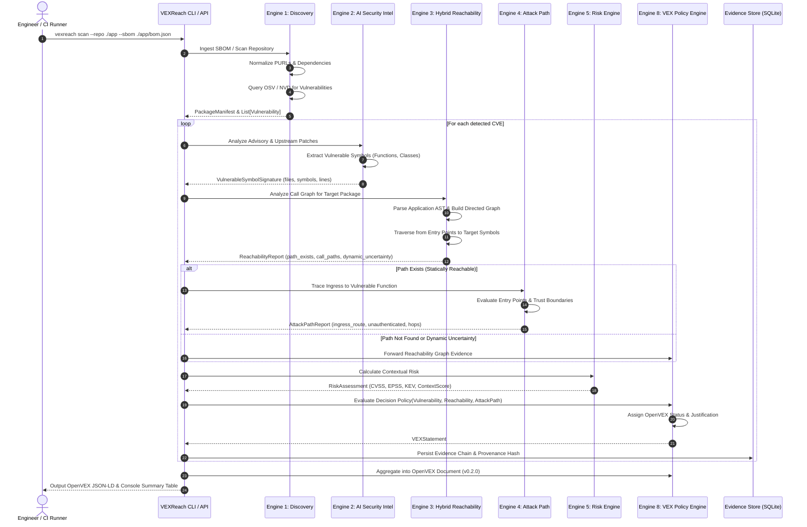

# VEXReach: End-to-End Data Flow Specification

## 1. Overview of the Assessment Lifecycle

VEXReach transforms raw, unstructured, and disparate security inputs into a deterministic, auditable **OpenVEX** document. The pipeline processes data through sequential refinement stages where each stage validates, enriches, and signs off on evidence artifacts.



---

## 2. Refinement Stages & Data Transformations

### Stage 1: Ingestion & Discovery Normalization (Implemented in Phase 3)
- **Input**:
  - Local repository/filesystem directory path: `Path` (validated without executing target files).
- **Transformation**:
  - `TrivyClient` generates a CycloneDX JSON SBOM (`sbom-cyclonedx.json`) and raw vulnerability report (`raw-trivy-vuln.json`).
  - `CycloneDXParser` validates CycloneDX 1.4/1.5/1.6 structure, extracts `direct` vs. `transitive` dependency scopes, and determines SBOM completeness (`complete`, `incomplete`, `failed`).
  - `TrivyReportParser` validates raw Trivy JSON structure (rejecting arbitrary/unrelated JSON).
  - `DiscoveryNormalizer` normalizes PURLs, ecosystems, severities, and multi-vendor CVSS metrics into canonical `PackageRecord` and `VulnerabilityRecord` instances linked by `package_id` without duplicating package metadata.
  - `EvidenceStore` persists raw artifacts, normalized `DiscoveryResult` (`discovery-assessment.json`), and SHA-256 `provenance.json`.
- **Output Data Models (`packages/core/models/discovery.py`)**:
  ```python
  class PackageRecord(VEXReachBaseModel):
      package_id: str
      name: str
      version: str | None
      ecosystem: str
      purl: str | None
      dependency_scope: DependencyScope  # direct | transitive | unknown
      source_metadata: dict[str, Any]

  class VulnerabilityRecord(VEXReachBaseModel):
      vulnerability_id: str
      package_id: str
      installed_version: str | None
      fixed_version: str | None
      severity: SeverityLevel
      cvss: list[CVSSMetric]
      description: str
      references: list[str]
      primary_url: str | None
      source: str
      detection_timestamp: datetime
  ```
- *(Phase 4 Implemented)*: `IntelligenceOrchestrator` enriches `DiscoveryResult` via `OSVClient` (`/v1/querybatch` + `/v1/vulns/{id}`), caches advisories in `SQLiteAdvisoryCache`, runs `VulnerabilityCorrelator` and `VersionRangeEvaluator` (PEP 440 / SemVer 2.0.0), persists `raw-osv-responses.json`, and attaches `VulnerabilityIntelligenceReport` onto `DiscoveryResult.intelligence` without discarding original scanner records.

### Stage 2: Function-Level Vulnerability Identification *(Implemented — Milestone 3)*
- **Input**: `DiscoveryResult` + upstream commit/patch diffs + optional local dependency ASTs + quarantined LLM extraction.
- **Transformation**:
  - `PatchFetcher` retrieves local or allowlisted HTTPS commit diffs with SSRF checks and SHA-256 digests.
  - `patch_parser` extracts unified diff hunks and compares Python ASTs (before/after or dependency line alignment).
  - `PromptSanitizer` isolates untrusted advisory/patch content and strips disallowed LLM security verdict claims.
  - `CandidateSymbolValidator` validates syntax, package import roots, and dependency AST presence (`CandidateVulnerableSymbol`).
- **Output Data Model**: `AIAdvisoryIntelligenceReport` (`packages/core/models/ai_intelligence.py`) generating validated `VulnerabilitySymbolManifest`, persisted to `ai-intelligence.json`, `raw-patch-evidence.json`, and `candidate-symbols.json`.

### Stage 3: Static Call Graph & Reachability Evaluation *(Python AST Implemented — Phase 5)*
- **Input**: Application Source Code AST + `VulnerabilitySymbolManifest` (+ optional `EntryPointConfig` & local `--dependency-source`).
- **Transformation**:
  - Python `ast` discovery & symbol extractor collects functions, async functions, classes, methods, nested `<locals>`, `__main__` blocks, and scoped imports without executing code.
  - `PythonCallGraphBuilder` constructs a bounded `networkx.DiGraph` with repository-relative POSIX `CodeLocation` metadata.
  - `EntryPointDetector` maps explicit config rules, `__main__` guards, FastAPI/Flask routes, and Typer/Click CLI commands.
  - Bounded path traversal enumerates simple paths (`nx.all_simple_paths` + `nx.has_path` depth-exceeded guard) from entry points to candidate dependency symbols.
  - Dynamic behaviors (`getattr`, `eval`, `exec`, `__import__`, `importlib.import_module`, wildcard imports, subscript dispatch, ambiguous receivers) are recorded as `UnresolvedCall` / `AnalysisDiagnostic`.
- **Output Data Model** (`packages/core/models/reachability.py`):
  - `ReachabilityState`: `reachable`, `no_path_within_supported_subset`, `unresolved`, `analysis_incomplete`, `missing_candidate_symbols`, `target_symbol_not_found`.
  - `StaticReachabilityReport` attached optionally to `DiscoveryResult.reachability`, with standalone `reachability-analysis.json`, `call-graph.json`, `candidate-symbols.json`, and SHA-256 `provenance.json`.

### Stage 4: Attack Path Modeling *(Implemented — Milestone 4)*
- **Input**: `StaticReachabilityReport` (`REACHABLE` paths) + Python AST `FunctionSymbol`s.
- **Transformation**:
  - `classify_entry_surface` classifies ingress (`network_http_public`, `network_http_authenticated`, `cli_local_input`, `internal_function`) and inspects auth decorators / FastAPI `Depends` parameters.
  - `trace_taint_along_path` propagates tainted parameters and ambient inputs across AST hops, recording `tainted_flow_observed`, `call_path_only_taint_not_proven`, or `sanitized_or_validated`.
- **Output Data Model**: `AttackPathReport` & `AttackPathRecord` (`packages/core/models/attack_path.py`) persisted to `attack-paths.json`.

### Stage 5: Deterministic Policy Evaluation & OpenVEX Emission *(Implemented — Milestone 5)*
- **Input**: `DiscoveryResult` (dependencies, SBOM, OSV intelligence, static reachability, attack paths, optional runtime observations).
- **Policy Rules (`packages/core/policies/vex_policy.py`)**:
  1. `REACHABLE` path or confirmed runtime observation -> `affected` (`action_statement` + fix hints).
  2. Advisory-vs-scanner conflict, incomplete SBOM/scan, missing/unverified dependency symbols, dynamic unresolved calls, or truncated/incomplete static analysis -> `under_investigation`.
  3. Complete `NO_PATH_WITHIN_SUPPORTED_SUBSET` + `VERIFIED_IN_DEPENDENCY_SOURCE` + complete SBOM/scan + zero unresolved calls + conflict-free intelligence -> `not_affected` (`vulnerable_code_not_in_execute_path`).
- **Output Data Model**: Validated `OpenVEXDocument` (`openvex.vex.json`), `OpenVEXPolicyReport` (`policy-evaluation.json`), and SQLite revision history (`SQLiteVEXStore`).

---

## 3. Provenance and Audit Verification

Every generated OpenVEX statement contains an immutable cryptographic hash of its inputs:
$$\text{EvidenceHash} = \text{SHA256}(\text{SBOM\_Hash} \parallel \text{Git\_Commit\_SHA} \parallel \text{CallGraph\_Hash} \parallel \text{Policy\_Version})$$

This prevents unverified modifications and allows third-party auditors to re-run VEXReach against the original source commit and verify the exact graph topology that led to the verdict.
