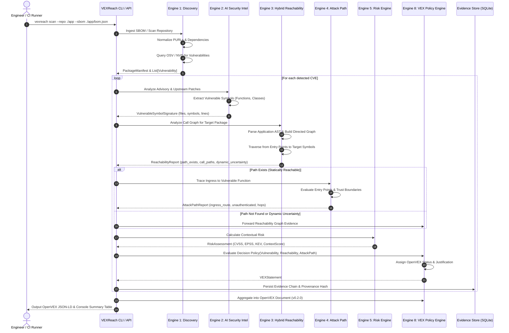

# VEXReach: End-to-End Data Flow Specification

## 1. Overview of the Assessment Lifecycle

VEXReach transforms raw, unstructured, and disparate security inputs into a deterministic, auditable **OpenVEX** document. The pipeline processes data through sequential refinement stages where each stage validates, enriches, and signs off on evidence artifacts.



---

## 2. Refinement Stages & Data Transformations

### Stage 1: Ingestion & Discovery Normalization (Implemented in Phase 3)
- **Input**:
  - Local repository/filesystem directory path: `Path` (validated without executing target files).
- **Transformation**:
  - `TrivyClient` generates a CycloneDX JSON SBOM (`sbom-cyclonedx.json`) and raw vulnerability report (`raw-trivy-vuln.json`).
  - `CycloneDXParser` validates CycloneDX 1.4/1.5/1.6 structure, extracts `direct` vs. `transitive` dependency scopes, and determines SBOM completeness (`complete`, `incomplete`, `failed`).
  - `TrivyReportParser` validates raw Trivy JSON structure (rejecting arbitrary/unrelated JSON).
  - `DiscoveryNormalizer` normalizes PURLs, ecosystems, severities, and multi-vendor CVSS metrics into canonical `PackageRecord` and `VulnerabilityRecord` instances linked by `package_id` without duplicating package metadata.
  - `EvidenceStore` persists raw artifacts, normalized `DiscoveryResult` (`discovery-assessment.json`), and SHA-256 `provenance.json`.
- **Output Data Models (`packages/core/models/discovery.py`)**:
  ```python
  class PackageRecord(VEXReachBaseModel):
      package_id: str
      name: str
      version: str | None
      ecosystem: str
      purl: str | None
      dependency_scope: DependencyScope  # direct | transitive | unknown
      source_metadata: dict[str, Any]

  class VulnerabilityRecord(VEXReachBaseModel):
      vulnerability_id: str
      package_id: str
      installed_version: str | None
      fixed_version: str | None
      severity: SeverityLevel
      cvss: list[CVSSMetric]
      description: str
      references: list[str]
      primary_url: str | None
      source: str
      detection_timestamp: datetime
  ```
- *(Phase 4 Implemented)*: `IntelligenceOrchestrator` enriches `DiscoveryResult` via `OSVClient` (`/v1/querybatch` + `/v1/vulns/{id}`), caches advisories in `SQLiteAdvisoryCache`, runs `VulnerabilityCorrelator` and `VersionRangeEvaluator` (PEP 440 / SemVer 2.0.0), persists `raw-osv-responses.json`, and attaches `VulnerabilityIntelligenceReport` onto `DiscoveryResult.intelligence` without discarding original scanner records.

### Stage 2: Function-Level Vulnerability Identification
- **Input**: `VulnerabilityRecord` + upstream Git commits/patches.
- **Transformation**:
  - Upstream patch diffs are inspected.
  - Tree-sitter AST comparisons identify modified functions and methods.
  - LLM heuristic agent structures and validates symbol signatures (with fallback to advisory regex matching).
- **Output Data Model**:
  ```python
  class VulnerableSymbolSignature(BaseModel):
      cve_id: str
      package_name: str
      module_path: str
      symbol_name: str # e.g. "urllib3.util.parse_url" or "yaml.load"
      signature_type: Literal["function", "method", "class"]
      confidence: float # [0.0 - 1.0]
      provenance_source: str # commit URL, advisory reference
  ```

### Stage 3: Static Call Graph & Reachability Evaluation *(Python AST Implemented — Phase 5)*
- **Input**: Application Source Code AST + `VulnerabilitySymbolManifest` (+ optional `EntryPointConfig` & local `--dependency-source`).
- **Transformation**:
  - Python `ast` discovery & symbol extractor collects functions, async functions, classes, methods, nested `<locals>`, `__main__` blocks, and scoped imports without executing code.
  - `PythonCallGraphBuilder` constructs a bounded `networkx.DiGraph` with repository-relative POSIX `CodeLocation` metadata.
  - `EntryPointDetector` maps explicit config rules, `__main__` guards, FastAPI/Flask routes, and Typer/Click CLI commands.
  - Bounded path traversal enumerates simple paths (`nx.all_simple_paths` + `nx.has_path` depth-exceeded guard) from entry points to candidate dependency symbols.
  - Dynamic behaviors (`getattr`, `eval`, `exec`, `__import__`, `importlib.import_module`, wildcard imports, subscript dispatch, ambiguous receivers) are recorded as `UnresolvedCall` / `AnalysisDiagnostic`.
- **Output Data Model** (`packages/core/models/reachability.py`):
  - `ReachabilityState`: `reachable`, `no_path_within_supported_subset`, `unresolved`, `analysis_incomplete`, `missing_candidate_symbols`, `target_symbol_not_found`.
  - `StaticReachabilityReport` attached optionally to `DiscoveryResult.reachability`, with standalone `reachability-analysis.json`, `call-graph.json`, `candidate-symbols.json`, and SHA-256 `provenance.json`.

### Stage 4: Attack Path Modeling
- **Input**: `ReachabilityEvidence` + Application Route Context.
- **Transformation**:
  - Maps ingress entry points to network interfaces (e.g., `POST /api/v1/upload`).
  - Checks middleware stack for authentication/authorization decorators (`@login_required`, `@authenticate`).
  - Traces user-controlled argument propagation to vulnerable function invocations.
- **Output Data Model**:
  ```python
  class AttackPathRecord(BaseModel):
      ingress_point: str
      is_network_exposed: bool
      requires_authentication: bool
      path_hops: list[str]
      assumptions: list[str]
      missing_evidence: list[str]
  ```

### Stage 5: Deterministic Policy Evaluation & OpenVEX Emission
- **Input**: Correlated findings (`VulnerabilityRecord`, `ReachabilityEvidence`, `AttackPathRecord`, `RiskAssessment`).
- **Policy Rules**:
  1. If `ReachabilityStatus == REACHABLE`:
     - Status: `affected`
     - Action: Remediation required (upgrade or patch).
  2. If `ReachabilityStatus == UNREACHABLE` AND `len(unresolved_dynamic_calls) == 0`:
     - Status: `not_affected`
     - Justification: `vulnerable_code_not_in_execute_path`
     - Impact Statement: "Static call graph analysis of all entry points revealed no execution path to candidate vulnerable functions."
  3. If `ReachabilityStatus == DYNAMIC_UNCERTAINTY` OR `len(unresolved_dynamic_calls) > 0`:
     - Status: `under_investigation`
     - Justification: None (investigation in progress).
     - Impact Statement: "Dynamic dispatch or runtime reflection detected. Automated static reachability cannot guarantee unreachable status."
  4. If `package.version >= vulnerability.fixed_version`:
     - Status: `fixed`
     - Justification: None.
- **Output Data Model**: OpenVEX 0.2.0 document serialized to JSON-LD.

---

## 3. Provenance and Audit Verification

Every generated OpenVEX statement contains an immutable cryptographic hash of its inputs:
$$\text{EvidenceHash} = \text{SHA256}(\text{SBOM\_Hash} \parallel \text{Git\_Commit\_SHA} \parallel \text{CallGraph\_Hash} \parallel \text{Policy\_Version})$$

This prevents unverified modifications and allows third-party auditors to re-run VEXReach against the original source commit and verify the exact graph topology that led to the verdict.
