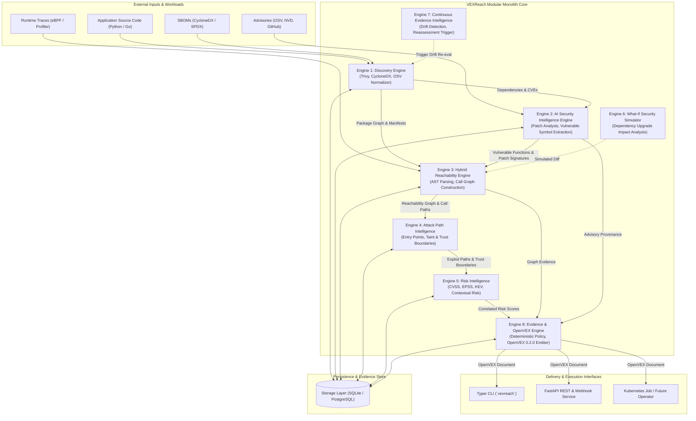

# VEXReach: System Architecture Specification

## 1. Executive Summary & Vision

**VEXReach** is an AI-assisted, Kubernetes-native vulnerability intelligence platform designed to bridge the gap between static package presence and practical exploitability. Modern software security tooling floods development and security teams with thousands of alerts based solely on package manifests or lockfile scans. In production environments, the vast majority of these dependencies are either:
1. Never invoked by the host application (dead code / uncalled dependency paths).
2. Invoked only in non-vulnerable branches or subroutines.
3. Isolated behind strict authentication, input validation, or configuration controls.

VEXReach deterministically correlates **Software Bill of Materials (SBOM)**, **security advisories**, **upstream patch diffs**, **static call graphs**, **runtime execution evidence**, and **attack paths** to generate explainable, auditable, and standards-compliant **OpenVEX** statements.

---

## 2. Non-Negotiable Security Principles

1. **Package Presence != Reachability**: The mere presence of a vulnerable library in an SBOM or virtualenv does not prove that vulnerable code can execute.
2. **Static Reachability != Exploitability**: A call path from an entry point to a vulnerable symbol indicates theoretical reachability, not that attacker-controlled payloads can trigger the vulnerability.
3. **Absence of Runtime Evidence != Unreachable**: A function not observed during runtime tracing cannot be declared unreachable (`not_affected`) unless static analysis or formal isolation guarantees it cannot be called.
4. **AI is an Investigator, Not an Oracle**: Large Language Models (LLMs) and heuristic models must never independently generate or approve security verdicts. All VEX statuses must be determined by deterministic, verifiable rules.
5. **Traceable Evidence & Provenance**: Every verdict must be backed by a directed graph path, AST node location, advisory identifier, or runtime execution trace.
6. **Explicit Uncertainty Representation**: If static analysis encounters unresolved dynamic dispatch (e.g., `getattr()`, `eval()`, reflection) or incomplete call graphs, it must explicitly record an `UNKNOWN` / `under_investigation` state rather than optimistically assuming safety.
7. **Security Correctness Over Performance/Marketing**: Correct vulnerability assessment takes strict precedence over minimizing false positives or producing flashy demonstrations.

---

## 3. High-Level Modular Monolith Architecture

VEXReach is structured as a **modular monolith**. Each engine possesses strict domain boundaries, typed Pydantic contracts, explicit inputs and outputs, and independent unit test suites.

---

## 4. The Eight Logical Engines

### Engine 1: Discovery Engine
- **Purpose**: Ingest target repositories, container images, and software packages.
- **Components**:
  - Ingestion adapter for Trivy (container & filesystem vulnerability scanning).
  - Parser for CycloneDX (1.4, 1.5) and SPDX (2.3) SBOM formats.
  - Package URL (purl) normalizer across PyPI, Go Modules, NPM, and Debian/Alpine.
  - Vulnerability metadata synchronizer connecting to OSV (Open Source Vulnerabilities), NVD (National Vulnerability Database), and CISA Known Exploited Vulnerabilities (KEV).
- **Guarantees**: Produces normalized, deduplicated package dependency trees with associated vulnerability identifiers.

### Engine 2: AI Security Intelligence Engine
- **Purpose**: Determine the exact function-level vulnerability footprint from upstream advisories and patch commits.
- **Components**:
  - Upstream patch commit fetcher (GitHub API, Git submodules).
  - Tree-sitter and AST diff analyzer comparing vulnerable vs. fixed commits.
  - LLM-assisted advisory reasoning agent equipped with schema-enforced structured outputs.
  - Vulnerable symbol extractor identifying file paths, class names, function names, and parameter signatures.
- **Security Boundary**: Treats all advisory text, commit messages, and repository diffs as **untrusted data**. Strict prompt isolation prevents prompt injection attacks from altering vulnerability classifications.

### Engine 3: Hybrid Reachability Engine
- **Purpose**: Determine whether candidate vulnerable functions can be reached from application entry points.
- **Components**:
  - Python AST visitor (`ast` module) and call graph builder (NetworkX directed graphs).
  - Go parser and call-graph analyzer (`golang.org/x/tools/go/callgraph` - planned Phase 9).
  - Symbol resolution engine tracking imports, aliases, class method dispatches, and transitive dependency chains.
  - Runtime execution collector (cProfile / OpenTelemetry / eBPF traces).
  - Dynamic behavior detector flagging reflection, `getattr`, `eval`, and dynamic imports as explicit uncertainty notes (`DYNAMIC_DISPATCH_UNRESOLVED`).

### Engine 4: Attack Path Intelligence
- **Purpose**: Model the realistic threat vector connecting an untrusted external actor to the vulnerable internal code.
- **Components**:
  - Entry point classifier (HTTP routes in FastAPI/Flask, CLI argument handlers, message queue subscribers).
  - Source-to-sink taint and data-flow approximations.
  - Trust boundary identification (authenticated vs. unauthenticated endpoints).
  - Human-readable path explainer detailing the step-by-step hops from external interface to vulnerable subroutine.

### Engine 5: Risk Intelligence
- **Purpose**: Calculate explainable, prioritized risk metrics based on environmental context.
- **Components**:
  - CVSS v3.1 / v4.0 metrics calculator.
  - EPSS (Exploit Prediction Scoring System) integration for exploit likelihood in the wild.
  - CISA KEV active exploitation indicator.
  - Contextual modifiers: Network exposure (internal vs. public-facing), reachability verdict (Reachable, Unreachable, Dynamic Uncertainty), and runtime observation.

### Engine 6: What-If Security Simulator
- **Purpose**: Enable safe, automated pre-upgrade verification before modifying production dependencies.
- **Components**:
  - Virtual dependency updater calculating delta between version $v_1$ and $v_2$.
  - Call graph regression tester detecting if the upgrade breaks public APIs or introduces new reachable CVEs.
  - Automated sandbox test executor running test suites against candidate dependency sets.

### Engine 7: Continuous Evidence Intelligence
- **Purpose**: Invalidate or update VEX statements when code, dependencies, or threat intelligence change.
- **Components**:
  - Git commit & SBOM drift watcher.
  - CVE advisory stream listener (detecting newly published advisories for existing packages).
  - Automated reassessment engine triggering partial graph re-evaluations without rescanning unchanged components.

### Engine 8: Evidence and OpenVEX Engine
- **Purpose**: Assemble verifiable evidence and emit cryptographic or digitally signed OpenVEX documents.
- **Components**:
  - Deterministic policy evaluator mapping graph state to standard OpenVEX statuses:
    - `affected`: Static or runtime reachability path verified.
    - `not_affected`: Proof of no static path within the closed-world assumption; explicit justification provided (e.g., `vulnerable_code_not_in_execute_path`, `vulnerable_code_not_present`).
    - `under_investigation`: Dynamic uncertainty present or advisory patch analysis incomplete.
    - `fixed`: Patch verified in current dependency version.
  - OpenVEX JSON-LD serializer compliant with the OpenVEX 0.2.0 specification.
  - Audit log recorder tracking analysis timestamps, tool versions, and cryptographic hashes of inputs.

---

## 5. Technology Stack & Design Decisions

| Category | Choice | Justification |
| :--- | :--- | :--- |
| **Primary Language** | Python 3.12+ (Compatible with 3.14) | Robust static analysis primitives (`ast`), rich graph libraries, fast prototyping of security models. |
| **Secondary Language** | Go (Phase 9+) | Native tooling for analyzing Go ecosystems (`golang.org/x/tools`), high-performance Kubernetes operators. |
| **Data Modeling** | Pydantic v2 | Strict type validation, immutable models, automatic JSON Schema generation, native serialization performance. |
| **CLI Framework** | Typer (Click-backed) | Type-safe, self-documenting developer tooling with structured terminal outputs. |
| **API Framework** | FastAPI | High-throughput asynchronous REST API for webhook triggers and CI/CD integrations. |
| **Graph Analysis** | NetworkX | Memory-efficient directed graph modeling for interprocedural call paths and reachability queries. |
| **Testing** | pytest + pytest-asyncio | Standardized testing ecosystem with fixture support for malicious / malformed security testbeds. |
| **Storage Engine** | SQLite (initially) -> PostgreSQL | Zero-setup local persistence for CLI runs; interface abstraction allows seamless drop-in of PostgreSQL. |
| **Security Standards** | OpenVEX 0.2.0, CycloneDX 1.5 | Industry-standard formats ensuring compatibility with enterprise vulnerability scanners and policy engines. |

---

## 6. Directory Layout & Boundaries

The repository strictly enforces module separation:
- `apps/`: User-facing executables (`apps/cli/`, `apps/api/`).
- `packages/core/`: Reusable, engine-level domain logic.
  - `models/`: Domain entities and Pydantic schemas.
  - `engines/`: Implementation of the 8 engines.
  - `integrations/`: Isolated adapters for third-party tools (Trivy, OSV, NVD).
  - `analysis/`: Ecosystem-specific code analyzers (`analysis/python/`, `analysis/go/`).
  - `policies/`: Pure, deterministic decision logic for VEX state assignment.
  - `storage/`: Abstract repository interfaces and SQLite implementations.
- `contracts/`: JSON Schemas and OpenVEX specification models.
- `tests/`: Comprehensive test corpus (unit, integration, fixtures with vulnerable/unreachable/dynamic code).
