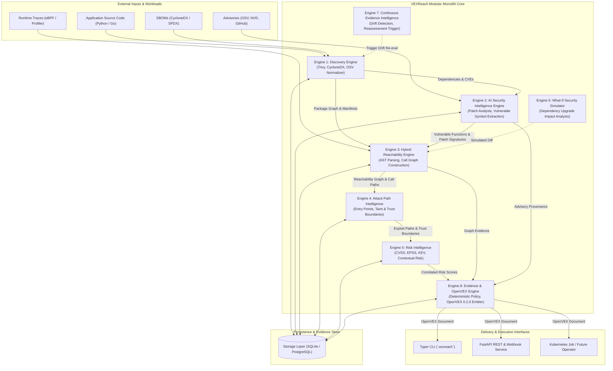

# VEXReach: System Architecture Specification

## 1. Executive Summary & Vision

**VEXReach** is an AI-assisted, Kubernetes-native vulnerability intelligence platform designed to bridge the gap between static package presence and practical exploitability. Modern software security tooling floods development and security teams with thousands of alerts based solely on package manifests or lockfile scans. In production environments, the vast majority of these dependencies are either:
1. Never invoked by the host application (dead code / uncalled dependency paths).
2. Invoked only in non-vulnerable branches or subroutines.
3. Isolated behind strict authentication, input validation, or configuration controls.

VEXReach deterministically correlates **Software Bill of Materials (SBOM)**, **security advisories**, **upstream patch diffs**, **static call graphs**, **runtime execution evidence**, and **attack paths** to generate explainable, auditable, and standards-compliant **OpenVEX** statements.

---

## 2. Non-Negotiable Security Principles

1. **Package Presence != Reachability**: The mere presence of a vulnerable library in an SBOM or virtualenv does not prove that vulnerable code can execute.
2. **Static Reachability != Exploitability**: A call path from an entry point to a vulnerable symbol indicates theoretical reachability, not that attacker-controlled payloads can trigger the vulnerability.
3. **Absence of Runtime Evidence != Unreachable**: A function not observed during runtime tracing cannot be declared unreachable (`not_affected`) unless static analysis or formal isolation guarantees it cannot be called.
4. **AI is an Investigator, Not an Oracle**: Large Language Models (LLMs) and heuristic models must never independently generate or approve security verdicts. All VEX statuses must be determined by deterministic, verifiable rules.
5. **Traceable Evidence & Provenance**: Every verdict must be backed by a directed graph path, AST node location, advisory identifier, or runtime execution trace.
6. **Explicit Uncertainty Representation**: If static analysis encounters unresolved dynamic dispatch (e.g., `getattr()`, `eval()`, reflection) or incomplete call graphs, it must explicitly record an `UNKNOWN` / `under_investigation` state rather than optimistically assuming safety.
7. **Security Correctness Over Performance/Marketing**: Correct vulnerability assessment takes strict precedence over minimizing false positives or producing flashy demonstrations.

---

## 3. High-Level Modular Monolith Architecture

VEXReach is structured as a **modular monolith**. Each engine possesses strict domain boundaries, typed Pydantic contracts, explicit inputs and outputs, and independent unit test suites.

---

## 4. The Eight Logical Engines

### Engine 1: Discovery & Vulnerability Intelligence (Phases 3–4 — Implemented for Local Filesystem, CycloneDX & OSV.dev)
- **Purpose**: Ingest target repositories safely without executing code, discover dependencies/vulnerabilities, and enrich findings with authoritative OSV.dev intelligence.
- **Implemented Components**:
  - `TargetValidator` (`packages/core/engines/discovery/target_validator.py`): Path, permission, symlink, and manifest hint verification.
  - `TrivyClient` & `TrivyReportParser` (`packages/core/integrations/trivy/`): Safe subprocess execution (`shell=False`, timeouts, bounded output, strict JSON checks) and isolated Trivy JSON parsing.
  - `CycloneDXParser` (`packages/core/integrations/cyclonedx/`): CycloneDX 1.4/1.5/1.6 SBOM parsing, direct/transitive dependency scope extraction, and completeness classification (`complete`, `incomplete`, `failed`).
  - `DiscoveryNormalizer` & `DiscoveryOrchestrator` (`packages/core/engines/discovery/`): PURL, severity, and CVSS normalization into canonical `DiscoveryResult` records with partial-failure preservation.
  - `OSVClient`, schemas & mapper (`packages/core/integrations/osv/`): OSV.dev v1 API integration (`/v1/query`, `/v1/querybatch` with pagination, `/v1/vulns/{id}`), bounded HTTP streaming, retries, and response validation.
  - `IntelligenceOrchestrator`, `VulnerabilityCorrelator`, `VersionRangeEvaluator` (`packages/core/engines/intelligence/`): Conservative ID/alias/package correlation, conflict preservation, and PEP 440 / SemVer 2.0.0 range evaluation.
  - `EvidenceStore` & `SQLiteAdvisoryCache` (`packages/core/storage/`): Persists raw Trivy, CycloneDX, and OSV payloads with SHA-256 `provenance.json`, plus local TTL/modified-aware SQLite advisory caching.
- **Planned Extensions**:
  - Container image scanning (`trivy image`), SPDX 2.3 ingestion, and NVD / CISA KEV / EPSS enrichment.
- **Guarantees**: Produces normalized, deduplicated package dependency records with evidence-backed vulnerability intelligence and explicit incomplete/conflict/error states.

### Engine 2: AI Security Intelligence Engine *(Implemented — Milestone 3)*
- **Purpose**: Determine the exact function-level vulnerability footprint from upstream advisories and patch commits.
- **Implemented Components (`packages/core/engines/ai_intelligence/`)**:
  - `PatchFetcher`: Local `.diff`/`.patch` ingestion and allowlisted HTTPS commit/PR diff fetcher (SSRF IP blocking, redirect checks, byte caps, SHA-256).
  - `patch_parser`: Unified diff parser and pre/post-patch Python AST comparator + dependency source line alignment.
  - `PromptSanitizer`: Strips control/ANSI sequences, quarantines untrusted advisory/diff blocks with per-request nonce XML delimiters, and logs indirect prompt-injection attempts.
  - `LLMProvider`: Interchangeable HTTP client abstraction (`DisabledLLMProvider`, `OpenAICompatibleLLMProvider`, `AnthropicLLMProvider`) stripping any unauthorized status verdicts (`not_affected`, `reachable`, `exploitable`).
  - `CandidateSymbolValidator`: Validates syntax, package import root membership, and dependency AST presence (`VERIFIED_IN_DEPENDENCY_SOURCE` / `ABSENT_IN_DEPENDENCY_SOURCE_AST`), keeping unverified AI symbols as `ai_assisted_unverified`.
- **Security Boundary**: Treats all advisory text, commit messages, and repository diffs as **untrusted data**. Strict prompt isolation prevents prompt injection attacks from altering vulnerability classifications.

### Engine 3: Hybrid Reachability Engine *(Python AST Static Reachability Implemented — Phase 5)*
- **Purpose**: Determine whether candidate vulnerable functions can be reached from application entry points.
- **Implemented Components (`packages/core/analysis/python/`)**:
  - Python source discovery (`PythonSourceDiscovery` with symlink skipping and `safe_resolve_path` containment) and AST parser (`ast` module, zero code execution).
  - Symbol, import, and call resolution tracking (`extract_module_symbols`, `extract_import_table`, `PythonCallResolver`) for sync/async functions, classes, methods, nested `<locals>`, aliases, relative imports, and typed/local-instance receivers.
  - Bounded `networkx.DiGraph` call graph construction (`PythonCallGraphBuilder`, `PythonCallGraph`) persisting `call-graph.json` and `reachability-analysis.json` with SHA-256 provenance.
  - Entry-point detection (`EntryPointDetector`) supporting explicit `EntryPointConfig`, `__main__` blocks, FastAPI, Flask, Typer, and Click routes/commands.
  - Dynamic construct & uncertainty tracking (`UnresolvedCall`, `AnalysisDiagnostic`) and 6-state conservative `ReachabilityState` classification (`reachable`, `no_path_within_supported_subset`, `unresolved`, `analysis_incomplete`, `missing_candidate_symbols`, `target_symbol_not_found`).
- **Planned Extensions**:
  - Go parser and call-graph analyzer (`golang.org/x/tools/go/callgraph` - planned later milestone).
  - Runtime execution collector (cProfile / OpenTelemetry / eBPF traces).

### Engine 4: Attack Path Intelligence *(Implemented — Milestone 4)*
- **Purpose**: Model the threat vector connecting external/CLI ingress to reachable dependency symbols while strictly separating call reachability from data-flow proof.
- **Implemented Components (`packages/core/engines/attack_path/`)**:
  - `classify_entry_surface`: Classifies `network_http_public`, `network_http_authenticated`, `cli_local_input`, `internal_function`, authentication decorators/`Depends(...)` barriers, and input parameters.
  - `trace_taint_along_path`: Conservative intra-procedural AST assignment and argument taint propagation distinguishing `tainted_flow_observed`, `call_path_only_taint_not_proven`, and `sanitized_or_validated`.
  - `AttackPathOrchestrator`: Generates explainable `AttackPathReport` linked to `DiscoveryResult.attack_paths` and `attack-paths.json`.

### Engine 5: Risk Intelligence
- **Purpose**: Calculate explainable, prioritized risk metrics based on environmental context.
- **Components**:
  - CVSS v3.1 / v4.0 metrics calculator.
  - EPSS (Exploit Prediction Scoring System) integration for exploit likelihood in the wild.
  - CISA KEV active exploitation indicator.
  - Contextual modifiers: Network exposure (internal vs. public-facing), reachability verdict (Reachable, Unreachable, Dynamic Uncertainty), and runtime observation.

### Engine 6: What-If Security Simulator
- **Purpose**: Enable safe, automated pre-upgrade verification before modifying production dependencies.
- **Components**:
  - Virtual dependency updater calculating delta between version $v_1$ and $v_2$.
  - Call graph regression tester detecting if the upgrade breaks public APIs or introduces new reachable CVEs.
  - Automated sandbox test executor running test suites against candidate dependency sets.

### Engine 7: Continuous Evidence Intelligence
- **Purpose**: Invalidate or update VEX statements when code, dependencies, or threat intelligence change.
- **Components**:
  - Git commit & SBOM drift watcher.
  - CVE advisory stream listener (detecting newly published advisories for existing packages).
  - Automated reassessment engine triggering partial graph re-evaluations without rescanning unchanged components.

### Engine 8: Evidence and OpenVEX Engine *(Implemented — Milestone 5)*
- **Purpose**: Assemble verifiable evidence and emit deterministic, schema-validated OpenVEX 0.2.0 documents with revision history.
- **Implemented Components (`packages/core/policies/`, `packages/core/engines/openvex/`, `packages/core/storage/`)**:
  - `evaluate_vex_policy`: Fail-closed deterministic rule evaluator checking scan/SBOM completeness, intelligence conflicts, candidate symbol dependency AST verification, and unresolved dynamic calls before permitting `not_affected` (`vulnerable_code_not_in_execute_path`). Defaults any uncertainty or conflict cleanly to `under_investigation`.
  - `validate_openvex_document` & `VEXStatement` validators: Enforce OpenVEX 0.2.0 structural invariants (`@context`, ISO timestamps, mandatory `justification`/`impact_statement` on `not_affected`).
  - `SQLiteVEXStore` & `EvidenceStore`: Tracks monotonic revision versions in SQLite and persists `openvex.vex.json` + `policy-evaluation.json` with SHA-256 hashes in `provenance.json`.

---

## 5. Technology Stack & Design Decisions

| Category | Choice | Justification |
| :--- | :--- | :--- |
| **Primary Language** | Python 3.12+ (Compatible with 3.14) | Robust static analysis primitives (`ast`), rich graph libraries, fast prototyping of security models. |
| **Secondary Language** | Go (Phase 9+) | Native tooling for analyzing Go ecosystems (`golang.org/x/tools`), high-performance Kubernetes operators. |
| **Data Modeling** | Pydantic v2 | Strict type validation, immutable models, automatic JSON Schema generation, native serialization performance. |
| **CLI Framework** | Typer (Click-backed) | Type-safe, self-documenting developer tooling with structured terminal outputs. |
| **API Framework** | FastAPI | High-throughput asynchronous REST API for webhook triggers and CI/CD integrations. |
| **Graph Analysis** | NetworkX | Memory-efficient directed graph modeling for interprocedural call paths and reachability queries. |
| **Testing** | pytest + pytest-asyncio | Standardized testing ecosystem with fixture support for malicious / malformed security testbeds. |
| **Storage Engine** | SQLite (initially) -> PostgreSQL | Zero-setup local persistence for CLI runs; interface abstraction allows seamless drop-in of PostgreSQL. |
| **Security Standards** | OpenVEX 0.2.0, CycloneDX 1.5 | Industry-standard formats ensuring compatibility with enterprise vulnerability scanners and policy engines. |

---

## 6. Directory Layout & Boundaries

The repository strictly enforces module separation:
- `apps/`: User-facing executables (`apps/cli/`, `apps/api/`).
- `packages/core/`: Reusable, engine-level domain logic.
  - `models/`: Domain entities and Pydantic schemas.
  - `engines/`: Implementation of the 8 engines.
  - `integrations/`: Isolated adapters for third-party tools (Trivy, OSV, NVD).
  - `analysis/`: Ecosystem-specific code analyzers (`analysis/python/`, `analysis/go/`).
  - `policies/`: Pure, deterministic decision logic for VEX state assignment.
  - `storage/`: Abstract repository interfaces and SQLite implementations.
- `contracts/`: JSON Schemas and OpenVEX specification models.
- `tests/`: Comprehensive test corpus (unit, integration, fixtures with vulnerable/unreachable/dynamic code).
