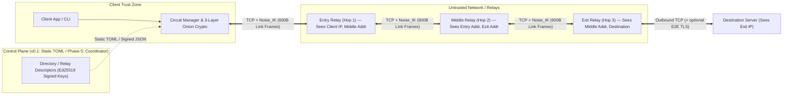
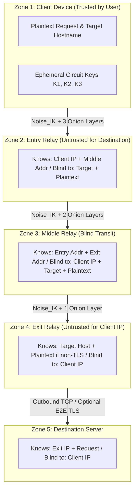
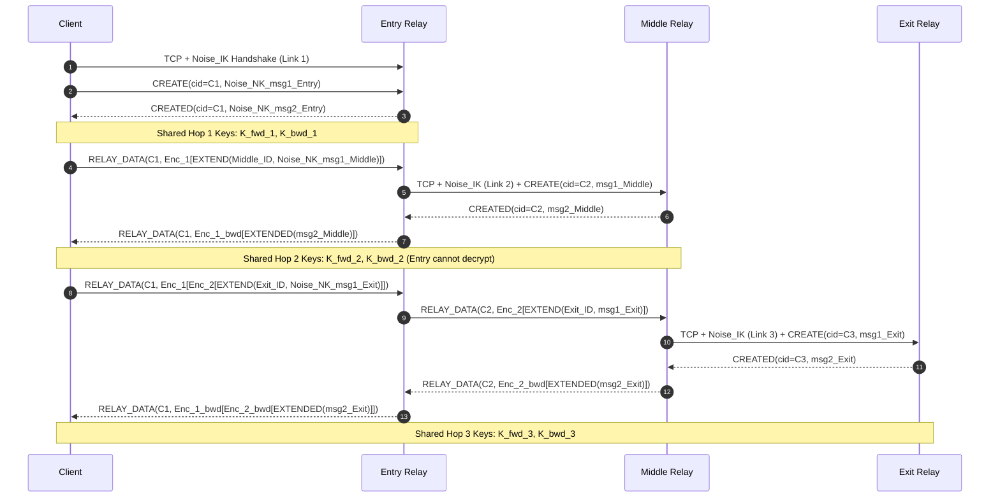
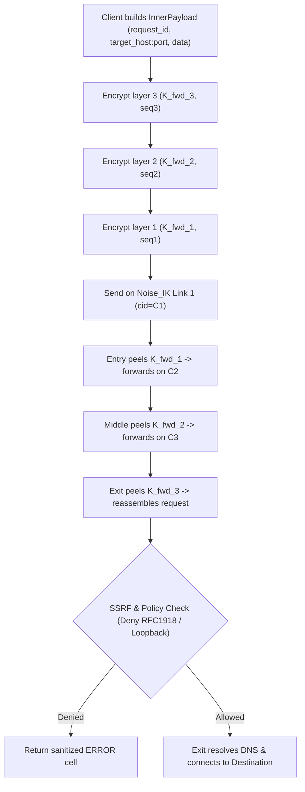
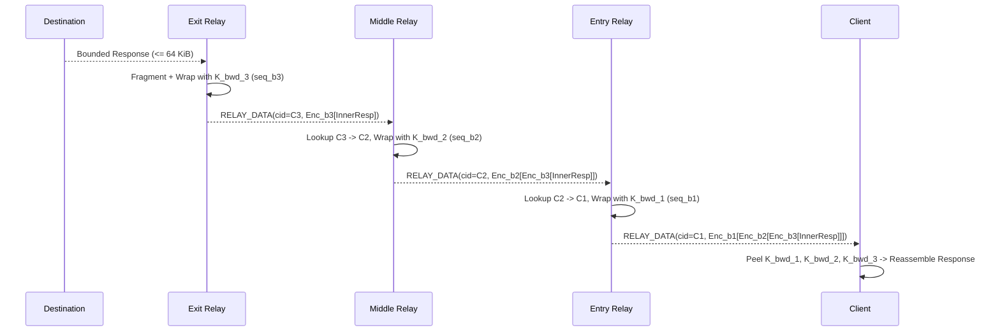
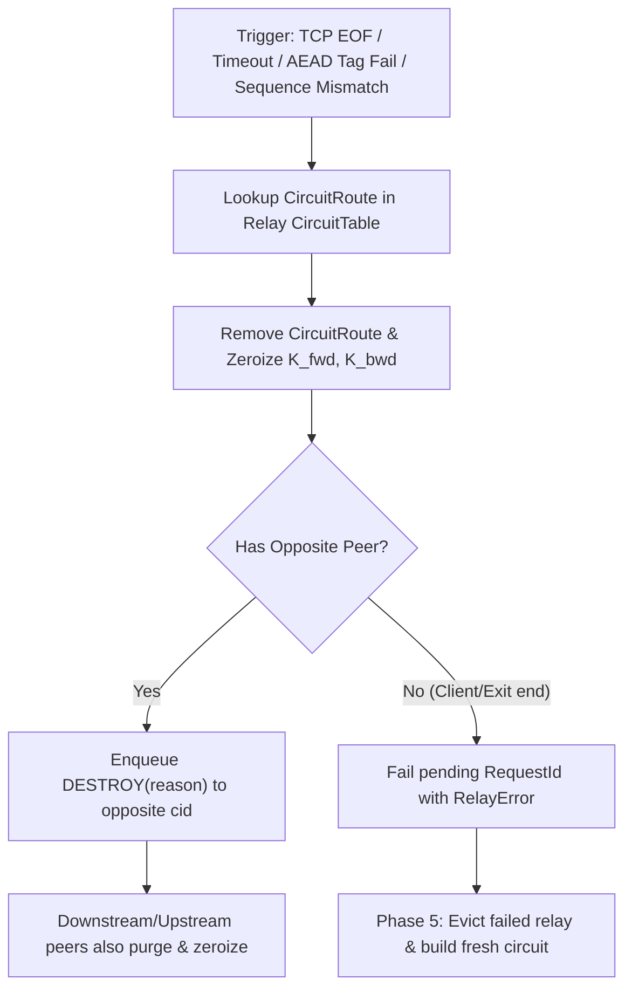

# Architecture — Private-Relay Protocol (`v0.1`)

---

## 1. High-Level System Architecture

---

## 2. Component Responsibilities & Trust Boundaries

1. **Client (`crates/client/`):**
   - Loads verified relay descriptors (`v0.1`: `ClientConfigFile` TOML via `relay-keygen` / `client.toml`; `Phase 5`: signed Coordinator snapshot).
   - Initiates telescopic 3-hop circuit (`CREATE` → `EXTEND` → `EXTEND`) using ephemeral per-session `Noise_IK` keypairs.
   - Wraps bounded requests (`<= 64 KiB`) into fixed inner fragments, encrypts 3 times (`Exit → Middle → Entry`), sends over Entry's `Noise_IK` link, and peels 3 response layers.
2. **Protocol Framing (`crates/protocol/`):**
   - Pure, zero-I/O binary serialization/deserialization for `OuterFramePlaintext` (`600` bytes), `LinkFrame::RekeyControl` (`D-09`), `Cell` (`9B` header), `ExtendDirective`, `RelayHopPlaintext`, and `InnerPayload`.
   - Enforces strict bounds and length invariants prior to crypto or allocation.
3. **Cryptographic Engine (`crates/crypto/`):**
   - Wraps `snow v0.9.6` (`Noise_IK` outer links + synchronized Section 4.2/11.3 link rekeying `D-09`, `Noise_NK` inner telescopic hops + `D-08` transcript-salted HKDF exporter), `hkdf`, `chacha20poly1305`, and `zeroize`.
   - Owns directional cipher states (`HopCipherPair`) with strict monotonic `u64` nonce sequence checks and X25519 keypair consistency validation.
4. **Network & Policy Layer (`crates/network/`):**
   - Owns typed TOML configuration validation (`RelayConfig`, `ClientConfigFile`), `DestinationPolicy` (DNS-once SSRF blocking), and async `LinkReader`/`LinkWriter` transport halves.
5. **Relay Core (`crates/relay/`):**
   - Operates uniformly across `Entry`, `Middle`, and `Exit` roles via configuration (`role = "entry" | "middle" | "exit"`).
   - Enforces accept-time `max_concurrent_connections` semaphore, `max_concurrent_circuits`, Entry `max_circuits_per_peer_ip`, bounded `mpsc` channels, cancellation-safe hop extension, and direct validated `SocketAddr` connect at Exit.
6. **CLI Binaries (`crates/cli/`) & Local Demo (`demo/`):**
   - Standalone executables (`relay-entry`, `relay-middle`, `relay-exit`, `relay-client`, `demo-dest`, `relay-keygen`) running as separate OS processes over localhost TCP sockets.
7. **Coordinator (`coordinator/` — Deferred to Phase 5):**
   - Optional HTTP/Axum registry + PostgreSQL store for relay health and signed descriptor publishing. Not created until Phase 5.

### Cryptographic & Trust Boundaries
- **Boundary 1 (Client OS):** Plaintext & destination exist in Client RAM. Protected only by Client host security.
- **Boundary 2 (Wire Links):** Protected by `Noise_IK` over TCP (`600B` fixed frames). Passive eavesdroppers cannot read cell commands or ciphertexts.
- **Boundary 3 (Entry ↔ Middle):** `Entry` strips layer 1 (`K_fwd_1`), revealing **only** `NextHop = Middle` and an encrypted blob for `Middle`.
- **Boundary 4 (Middle ↔ Exit):** `Middle` strips layer 2 (`K_fwd_2`), revealing **only** `NextHop = Exit` and an encrypted blob for `Exit`.
- **Boundary 5 (Exit ↔ Destination):** `Exit` strips layer 3 (`K_fwd_3`) and resolves `target_host:port`. Unless Client encrypts end-to-end via TLS inside the request, `Exit` sees application plaintext.

### 2.1 Trust Boundaries Diagram

---

## 3. Data Flow & Sequence Diagrams

### 3.1 Telescopic Circuit Establishment (`CREATE` → `EXTEND` → `EXTEND`)

### 3.2 Forward Request Lifecycle

### 3.3 Response Forwarding Lifecycle

### 3.4 Relay Failure & Teardown Handling

---

## 4. State Management

- **Stateless Framing vs. Stateful Circuits:** `protocol` is completely stateless. Relays store zero disk state for circuits. All circuit routing (`CircuitId -> { keys, seq_counters, bounded_tx_channel, last_active }`) lives exclusively in bounded RAM and vanishes on `DESTROY` or process restart.
- **Backpressure Invariant:** Each circuit allocates a bounded `tokio::sync::mpsc::channel(64)`. If a downstream peer stalls and fills the 64-cell queue, the relay enforces a short send timeout (`2s`) and tears down the stalled circuit rather than buffering unbounded memory.
